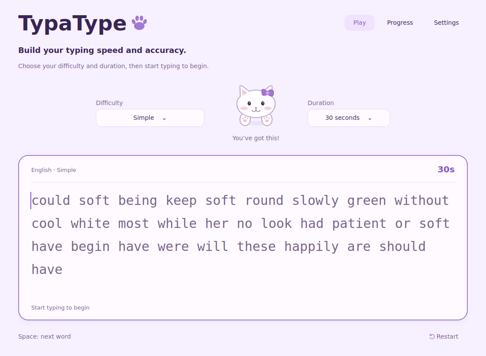
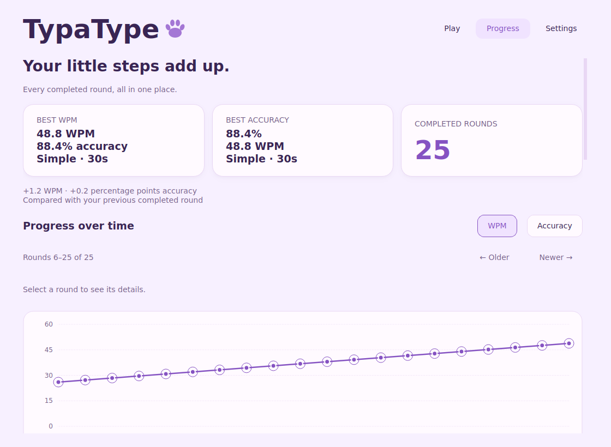
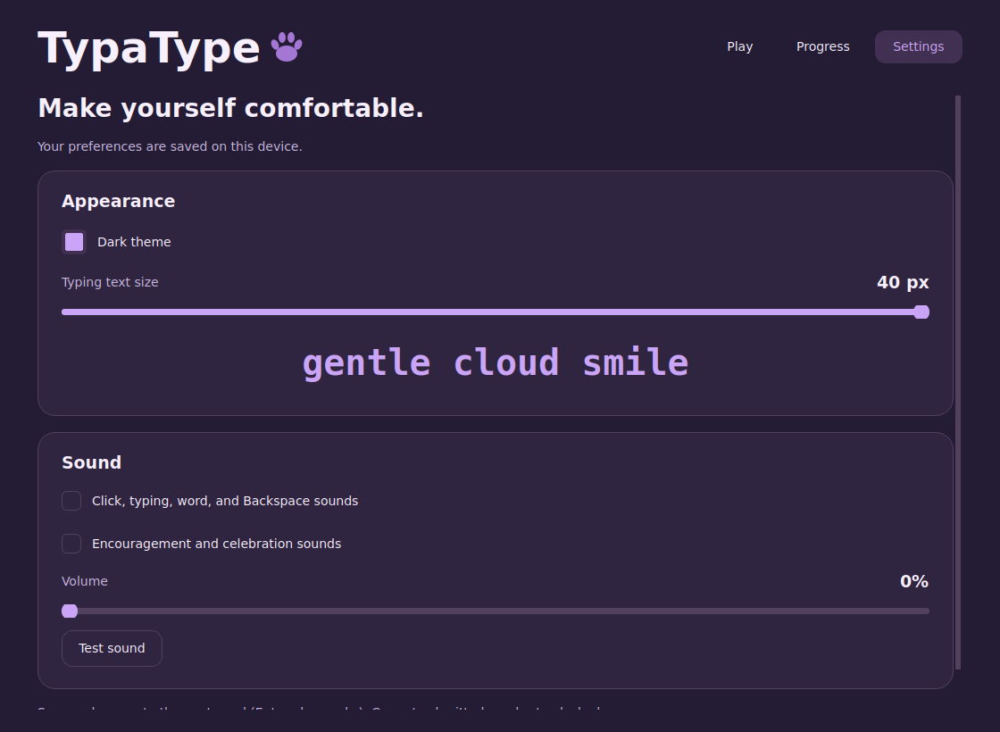

# TypaType

A small, offline C++17 / Qt 6 desktop typing game. A white kitten cheers you on in a soft violet interface. The application includes timed rounds, real results, local progress, light/dark themes, text-size controls, and quiet sound effects.

## Screenshots

### Play



### Progress



The progress screenshot uses sample rounds to demonstrate the chart.

### Settings



## Build and run

Requirements: CMake 3.16+, a C++17 compiler, and Qt 6.2+ with **Widgets**, **SVG**, **Multimedia**, and **Test** (when building tests).

On Ubuntu/Debian, install the development packages:

```bash
sudo apt-get install build-essential cmake qt6-base-dev qt6-svg-dev qt6-multimedia-dev
cmake -S . -B build -DCMAKE_BUILD_TYPE=Release
cmake --build build -j2
./run.sh
```

For a separately installed Qt SDK, pass its prefix:

```bash
cmake -S . -B build -DCMAKE_PREFIX_PATH=/path/to/Qt/6.x/gcc_64
cmake --build build -j2
./build/typatype
```

The current workspace has a compiled executable and a persistent, project-local Qt SDK in `.deps/qt`. It replaces the earlier temporary SDK, so clearing `/tmp` no longer breaks the app. No system packages were installed. The local SDK reuses this machine's installed Qt runtime libraries and is intended for this machine, rather than distribution to another computer.

On Debian/Ubuntu, you can recreate that local SDK without administrator privileges:

```bash
python3 scripts/setup_local_qt.py
./scripts/build.sh
./run.sh --data-dir "$PWD/.local-data"
```

SDK setup downloads packages once and needs network access. Builds and gameplay work offline afterward. `run.sh` incrementally rebuilds changed code before launching. To use another Qt SDK, set `TYPATYPE_QT_PREFIX=/path/to/Qt/6.x/gcc_64`. The shared scripts set the library/plugin paths and clear cached dependency paths when switching SDKs.

On macOS/Windows, use the same CMake project with your Qt installation and compiler. These platforms have not been built or tested here. For distribution, deploy the Qt runtime and plugins with your platform's Qt deployment tooling; this repository is source delivery, not a signed installer.

## Controls and rounds

- Fresh launches always select **Simple**, **30 seconds**, and **30 targets**. Appearance and sound preferences are restored.
- Choose **Simple**, **Punctuation**, or **Punctuation + Numbers**, and **15**, **30**, or **60 seconds**. Each duration generates exactly that many target tokens. The round does not append more words.
- The first printable character, including a wrong character, starts the monotonic countdown. Clicking, empty Space/Enter, empty Backspace, modifier keys, and shortcuts do not start it.
- **Space** submits a nonempty word and advances even when it is incorrect. Exact submitted words lock. Enter also works as an optional shortcut.
- Space submits the word without adding a character or an accuracy attempt. Repeated spaces on an empty word are ignored.
- **Backspace** deletes within the active word. From an empty active word or the end position, it can return to the adjacent editable word and delete its last character. A correctly submitted word is a boundary it cannot cross.
- Backspace clears the erased letter's feedback to the same neutral grey as untouched text, whether the erased attempt was correct or incorrect. Revisited words become editable again; remaining untyped letters stay grey until Space submits the word again. Later words retain their stored input. Correcting a word locks it when Space submits it again.
- Correct characters are violet. A wrong keystroke turns the **expected target letter red** without replacing it with the wrong letter. Backspace clears that attempt so you can correct it. Extra characters are shown in red; missing characters in submitted words have a red highlight and dotted underline.
- Six short sounds accompany button clicks, typing, advancing a word, Backspace, each ten-word kitten encouragement, and round completion. Cues preload silently before typing; clicks/typing/Backspace reuse multiple voices so rapid input does not skip sounds. Settings lets you mute clicks/typing/word/Backspace or encouragement/celebration separately and adjust the shared volume. Changing the system audio output updates the game's output automatically.
- The board wraps text and follows the caret, keeping the next line visible when more text remains. Its minimum height accommodates two complete lines at every text size.
- Difficulty and duration popups open four pixels from their respective selectors and stay within the screen. The kitten rotates encouragement messages and cycles through a smile, wink, and curious face while the Play page is visible.
- The timer continues if typing focus is lost. Completing all targets early leaves the timer running and only permitted corrections available.
- **Restart**, changing a selector, or leaving Play discards the attempt. Abandoned attempts are never recorded. Returning to Play and **Play Again** prepare fresh text.
- Only timer expiry completes a round. Results are frozen and saved once.

## Scores and progress

**WPM** uses the five-character convention:

```text
WPM = (credited characters / 5) / (selected duration / 60)
```

A credited character matches the expected position in the final stored input, including an unfinished active word. Each exactly matching submitted word also earns one separator. Wrong, extra, missing, and erased characters receive no credit. Repeatedly typing and deleting cannot inflate WPM.

**Accuracy** remembers every printable insertion:

```text
Accuracy = correct character attempts / total character attempts × 100
```

An insertion is correct only if it matches the target at its insertion position. Deleting or correcting mistakes does not erase those attempts. Space, Enter, Backspace, and shortcuts are not attempts; missing characters do not create fictional attempts. Zero attempts produce 0% safely. Full precision is saved; displays show one decimal place.

Progress combines all difficulties and durations, without bonuses. The latest completed round is compared with the immediately preceding saved round; accuracy changes use **percentage points**. The first recorded round has no invented comparison. Best WPM includes its round's accuracy and vice versa. Ties do not announce a new best; the first saved round establishes the initial best.

The chart initially shows the latest 20 completed rounds chronologically, with straight segments between actual observations. **Older** and **Newer** let you inspect earlier rounds. Accuracy spans 0–100%. Hover/click a point for date/time, both metrics, difficulty, duration, and target count. Clicked points keep their details after the pointer leaves; use Left/Right or Home/End while the chart has focus to inspect points with the keyboard. Rings mark rounds that established a new personal best at the time, rather than only the current maximum. The recent list shows the latest 20 results, newest first.

## Local data

History and preferences use Qt's per-user `QStandardPaths::AppDataLocation` for organization **TypaType** and application **TypaType**:

- Linux: usually `~/.local/share/TypaType/TypaType/` (or beneath `XDG_DATA_HOME`).
- Windows: beneath the user's local application-data folder, `TypaType/TypaType`.
- macOS: beneath `~/Library/Application Support/TypaType/TypaType/`.

On this machine, the default folder was verified as `/home/afa/.local/share/TypaType/TypaType`. The exact location follows Qt and your platform. Files are `history.json` and `preferences.ini`. Dates are saved in UTC and displayed in the computer's local timezone.

You can explicitly choose a location:

```bash
./run.sh --data-dir "$PWD/.local-data"
```

`history.json` contains a versioned JSON object and completed rounds with UUID, completion timestamp, difficulty, duration, target count, credited characters, total/correct attempts, full-precision WPM/accuracy, and schema version. `QSaveFile` performs atomic writes with direct-write fallback disabled. Loaded entries are checked for types, ranges, supported options, UUID/date validity, score consistency, and duplicate IDs. Invalid entries are skipped; malformed/unreadable containers are preserved and saving is blocked with an understandable message. A failed save is reported on the Results screen and does not announce a personal best. Preferences use `QSettings`.

History saves use `QLockFile`, reload the current file under the lock, then atomically append. Multiple current app windows cannot silently overwrite each other's results. If another window is saving, the app reports the failed save without blocking typing. A file damaged after startup is rechecked and preserved. Equivalent UUID spellings are treated as the same ID. Keep backups before manually editing saved data; external editors do not participate in the application's locking.

## Tests and verification

```bash
cmake -S . -B build
cmake --build build -j2
ctest --test-dir build --output-on-failure
```

The desktop test uses Qt's `offscreen` platform and disables actual audio playback. The full suite includes real 15-, 30-, and 60-second rounds and takes about two minutes. These checks verify timing and one-time saving while the typing board is unfocused. For fast checks after a UI-only edit, use:

```bash
ctest --test-dir build --output-on-failure -E realtime_rounds
```

With a working desktop audio output, run the separate sound check (short cues at 20% volume):

```bash
QT_QPA_PLATFORM=offscreen ./build/audio_tests
```

It verifies silent preloading, all five cues completing playback, rapid input, and mute/volume behavior. It is excluded from default CTest because machines without audio cannot run it.

To run just the dependency-free game rules:

```bash
cmake -S . -B build-core -DTYPATYPE_BUILD_APP=OFF
cmake --build build-core -j2
ctest --test-dir build-core --output-on-failure
```

Capture inspection images with:

```bash
TYPATYPE_SCREENSHOTS="$PWD/docs/screenshots" ctest --test-dir build --output-on-failure
```

See the [brief-by-brief implementation checklist](docs/implementation-status.md) and [verification notes](docs/verification.md) for completed work and remaining manual checks. Progress images whose names contain `fixture` use isolated test records, and results images whose names contain `test` use an artificially advanced clock. These records are never installed into the real player profile. Fresh real history is empty.

## Source layout

| Responsibility | Source |
| --- | --- |
| State, monotonic timing, locking, scoring | `src/core/GameSession.*` |
| Random vocabulary, category frequency, punctuation, numbers | `src/core/WordGenerator.*` |
| Versioned JSON history and preferences | `src/storage/Stores.*` |
| Keyboard input, feedback, wrapping, caret | `src/ui/TypingWidget.*` |
| Navigation, completion, save/error handling | `src/ui/MainWindow.*` |
| Play, Results, Progress chart/list, Settings, selection dialogs | `src/ui/Pages.*` |
| Palette and widget styles | `src/ui/ThemeManager.*` |
| Original SVG face/paws and brief expression gestures | `src/ui/MascotWidget.*` |
| Preloaded sound voices, output-device changes, category/volume gating | `src/ui/SoundManager.*` |
| Bundled words, three kitten expressions, SVG icons, five WAV effects | `assets/` |
| Reproduce original vector/audio assets | `scripts/generate_assets.py` |
| Persistent local SDK, incremental build, runtime paths | `scripts/setup_local_qt.py`, `scripts/build.sh`, `scripts/qt_environment.sh` |
| Game and desktop integration checks | `tests/` |

Assets are original project drawings and synthesized WAV tones; no network assets are needed at runtime. The kitten has only its face and front paws. UI fonts use installed system fonts.

The supplied brief is preserved in [docs/project-brief.txt](docs/project-brief.txt). Its written layout and palette guided implementation; an additional approved-design screenshot was not supplied. The later request to advance with Space and retain red target letters supersedes the original brief's input rules. No accounts, online services, extra modes, or preview-only controls are included.

Qt API references used: [QPainter](https://doc.qt.io/qt-6/qpainter.html), [QSvgRenderer](https://doc.qt.io/qt-6/qsvgrenderer.html), [QSoundEffect](https://doc.qt.io/qt-6/qsoundeffect.html), [QSaveFile](https://doc.qt.io/qt-6/qsavefile.html), [QLockFile](https://doc.qt.io/qt-6/qlockfile.html), [QVariantAnimation](https://doc.qt.io/qt-6/qvariantanimation.html).
